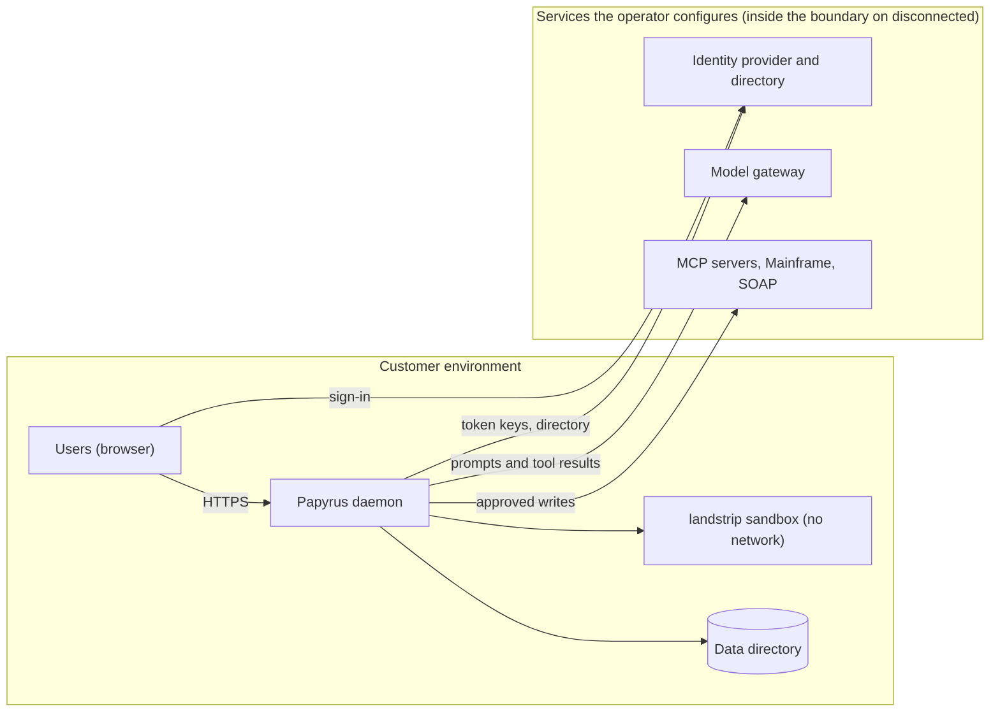
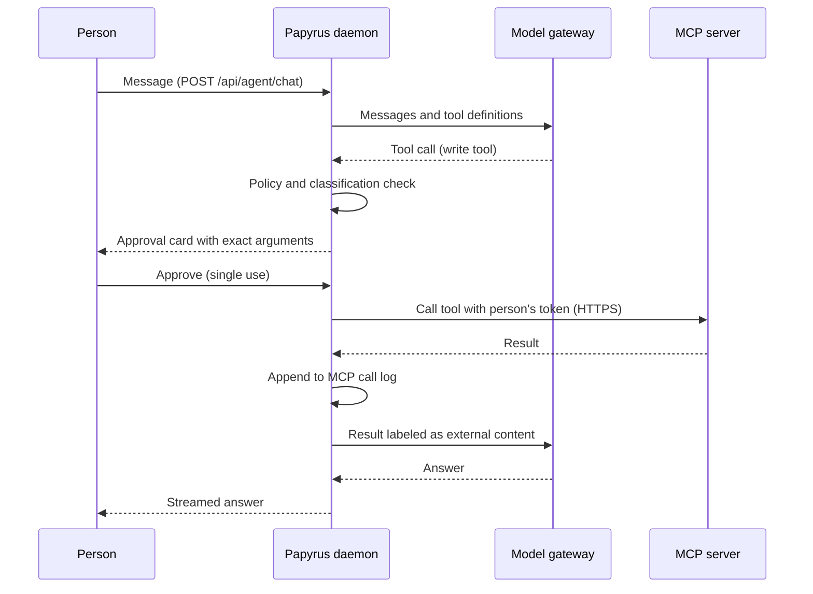
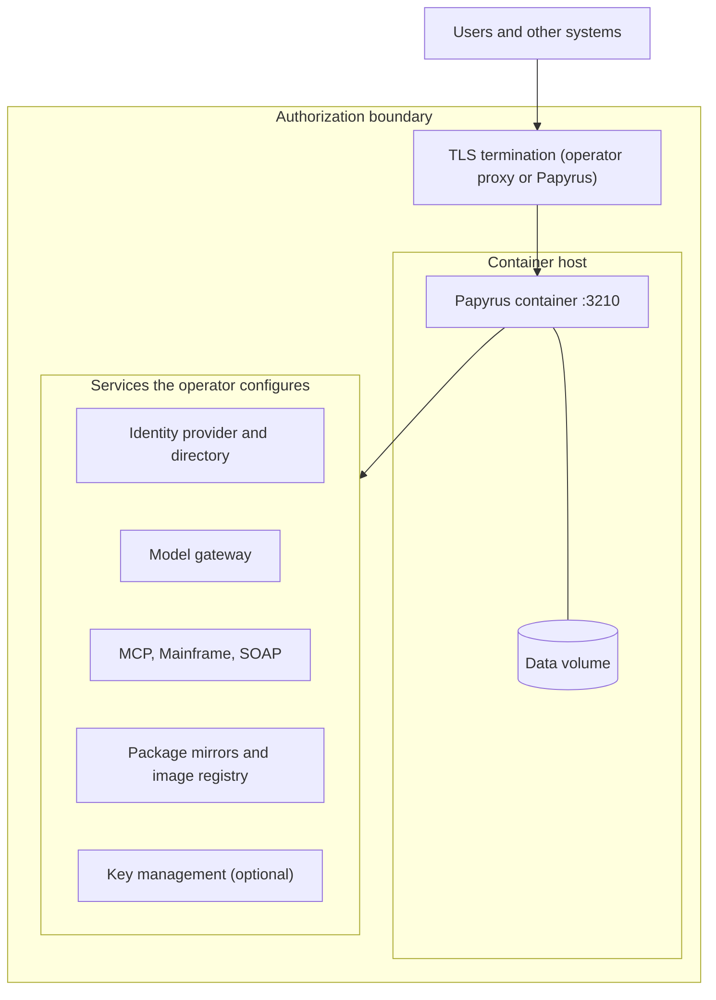

# Papyrus Architecture

Papyrus is a customer-hosted agent runtime published by Beag Labs. This document describes its components, trust boundaries, data flows, storage, and deployment topologies as implemented in the Papyrus source. Control-by-control detail is in the security controls matrix in the same evidence pack.

## Overview

Papyrus is a single-tenant daemon that runs AI agents and workflows inside the customer's own environment. Each deployment serves one Microsoft Entra tenant, keeps its state in local LibSQL/SQLite files under one data directory, reaches language models through gateways the customer configures, and reaches customer systems through MCP servers and native Mainframe TN3270 and SOAP connectors. Agents can read and propose; consequential writes require a human approval before they run. Papyrus is built on the Mastra agent framework (`@mastra/core`) and ships as one container image.

## System boundary

**Inside the boundary (this repository, running in the customer environment):**

- The Papyrus daemon (`apps/server`): portal and API, OpenID Connect sign-in and server-side sessions, append-only audit trail with OTLP export, Mastra agent runtime, workflows and scheduler, policy engine, action ledger and executors, MCP client, Teams and GitHub agent channels, update service.
- The web portal (`apps/web`), served as static files by the daemon.
- The workspace sandbox: `landstrip` workers (Landlock filesystem confinement plus seccomp, network denied) that run native document programs.
- The data directory (`PAPYRUS_DATA_DIR`, `/var/lib/papyrus` in the image).

**Services Papyrus depends on.** Each is reached at an address the operator configures, over whatever network path the operator provides; none has to be on the public internet. The deployment profile (`commercial`, `government` or `disconnected`) states what Papyrus may assume: on `disconnected`, every service below is an endpoint inside the authorization boundary, and Beag Labs services are not used.

| Service | What Papyrus relies on it for | When it applies |
| --- | --- | --- |
| Identity provider (OpenID Connect, or Microsoft Entra ID) | Human identity: signed tokens, groups, roles | Every deployment |
| Directory (Microsoft Graph or SCIM 2.0) | Staff directory and provisioning | When an administrator enables them |
| Model gateway | Model inference over an OpenAI-compatible API | Agent work |
| Customer systems (MCP servers, Mainframe hosts, SOAP services) | Data and actions the customer connects | When configured |
| External key management service | Credential storage, instead of the local encrypted store | When the deployment uses one |
| Beag Labs license authority public keys | Verifying licenses | Every deployment; the keys are built into Papyrus, not configured and not a network call |

Papyrus calls no Beag Labs service. Licenses are verified locally against the license authority public keys built into Papyrus (`apps/server/src/license.ts`, `verifyAuthoritySignature`).

## Runtime components

| Component | Role | Process / container | Key code path |
| --- | --- | --- | --- |
| HTTP server and portal | Serves the portal, REST and streaming APIs, workflow webhooks and agent channel webhooks; validates identity-provider tokens and portal cookies | Daemon process (Node 24), port `3210` | `apps/server/src/agent/http.ts`, `apps/server/src/index.ts` |
| Identity and sessions | OIDC/Entra sign-in, system use notice, server-side sessions, role assignments | Daemon | `auth.ts`, `portal-sessions.ts`, `role-assignments.ts` |
| Audit | Append-only audit trail, OTLP export, Audit page | Daemon | `audit/log.ts`, `audit/otlp.ts` |
| Agent Roster | Named agents, signed revisions, approvals, sessions, background tasks | Daemon | `roster/` |
| Agent runtime | Mastra agents, sessions, memory, workflows, scheduler, signals | Daemon | `apps/server/src/agent/mastra/runtime.ts` |
| Model gateway | Resolves model profiles and credentials; calls OpenAI-compatible endpoints | Daemon | `model-gateway.ts`, `model-store.ts` |
| Policy engine | Deterministic named policy rules at model, tool, connector, and action boundaries | Daemon | `apps/server/src/agent/policies/` |
| Action ledger and executors | Proposal, approval, leased execution for Mainframe TN3270, legacy SOAP, appliance console | Daemon; TN3270 uses a Python bridge child process | `action-store.ts`, `action-worker.ts`, `executors/`, `scripts/tn3270-bridge.py` |
| MCP connector runtime | Registers, verifies, classifies, and calls MCP servers; per-person OAuth tokens | Daemon | `apps/server/src/agent/mcp/` |
| AgentFS workspace | Durable file authority for Library and session workspaces | Daemon (SQLite via `agentfs-sdk`) | `mastra/workspace-agentfs.ts` |
| Workspace sandbox | Runs fixed native tools (Python, Pandoc, LibreOffice) on a materialized copy of the workspace | `landstrip` worker child processes | `mastra/workspace-nono.ts`, `mastra/workspace-nono-worker.ts` |
| Knowledge Index | Local document embeddings with a pinned Nomic model on CPU | Node worker thread | `document-embeddings.ts`, `embedding-worker.ts`, `scripts/embedding-model.mjs` |
| Update service | Receives signed release announcements; requests host updates | Daemon; applied by a host-side updater where the host runs one | `apps/server/src/agent/updates/service.ts`, `deploy/marketplace/vm/papyrus-update.sh` |

## Model gateways

**How models are reached.** All chat models are called through one Mastra custom gateway (`PapyrusModelGateway`, `apps/server/src/agent/model-gateway.ts`) that uses `@ai-sdk/openai-compatible`. Each model profile names a base URL, a model, an authentication scheme, and a credential reference. Any provider that exposes an OpenAI-compatible chat completions API can be used. The gateway kinds accepted by the API are `openai-compatible`, `azure-openai`, `ollama`, and `custom` (`packages/contracts/src/index.ts`, `MODEL_GATEWAY_KINDS`). There is no native Anthropic, Bedrock, or Vertex client in the server; those providers are usable only through an OpenAI-compatible endpoint or proxy. When a profile is tested, the gateway reads the provider's `/models` catalog with an 8-second timeout; model calls have a 60-second response-header timeout.

**Endpoint rules.**

- Base URLs must be HTTPS. Plain HTTP is accepted only for `localhost` (`model-store.ts`, `normalizeInput`).
- Model gateways are listed in `papyrus.yaml` (`models.gateways`) and tested at startup; the app shows them read-only. The `government` and `disconnected` profiles never default to a commercial endpoint, and an explicit `api.openai.com` or `openai.azure.com` endpoint logs a warning on those profiles. The `ollama` provider defaults to `http://localhost:11434/v1`.
- Without a configured model, sessions, workflows, and connector state still start; work that needs a model is unavailable.

**Where credentials live.** A profile stores only a reference (`env://`, `local://`, `keyvault://`, and other reference schemes; inline values are rejected):

| Reference | Storage |
| --- | --- |
| `local://<profile>` | AES-256-GCM ciphertext in `<data-dir>/secrets.db` (file mode 0600), keyed by a separately provisioned 32-byte master key mounted read-only (`/etc/papyrus/secrets/master.key` or `PAPYRUS_SECRET_KEY_FILE`) (`local-secrets.ts`) |
| `keyvault://…` | A secret in an external key vault, read with the deployment's own identity (`deployment-vault.ts`) |
| `env://VAR` | A process environment variable |

Saved keys are never returned by the API, never placed in model context, and never given to agent workspaces.

**What data leaves.** For each model request, the daemon sends the conversation messages, system instructions, tool definitions, tool results (MCP results are labeled as external content and truncated to 64 KiB), retrieved document passages, and, for vision-capable models, image attachments and rendered PDF pages. Credentials for connectors and MCP servers are never sent. Document embeddings are computed locally and do not leave the deployment.

## Integrations

**MCP connectors** (`apps/server/src/agent/mcp/`). Administrators with `Papyrus.Integration.Manage` register remote MCP servers over HTTP transport; there is no stdio transport. A server offers tools only after a verified connection. Each tool is classified `read`, `write`, or `blocked`; new or changed tools default to unreviewed write, and server-supplied hints are not trusted. OAuth tokens are held per server and per person and encrypted in the database. Every call rechecks tenant, verification, classification, and policy. A write requires a single-use approval of that exact call, given by the person whose session made it. Every call is recorded in an append-only log (`papyrus_mcp_calls`) that stores arguments for writes, only a hash for reads, and never tokens or results.

**Workflow webhooks** (`apps/server/src/agent/workflow-webhooks.ts`). `POST /hooks/<id>` is one of the few routes other systems reach without a session (with agent webhook channels and the Teams and GitHub endpoints). It starts one run of a published workflow with a webhook trigger, after checking the signature against a server-generated secret that is stored encrypted and shown once to the workflow's owner.

**Microsoft Graph.** When Entra is the identity provider, Graph serves the staff directory, using the deployment's own app credentials with the `User.Read.All` application permission (`directory/people.ts`). Graph endpoints follow the configured identity cloud (`PAPYRUS_ENTRA_CLOUD`, `national-cloud.ts`). Mailbox and other Microsoft 365 data access is through an MCP server, not a native connector.

**Legacy systems.** Mainframe TN3270 connections run through a Python `tnz` bridge process with optional TLS per connection (`apps/server/src/agent/apps/legacy/tn3270-session.ts`); every key an agent submits needs a person's approval and passes through Mainframe guardrails. Legacy SOAP services are called over HTTP(S) with document/literal bindings. Both are verified live when set up.

**Imported APIs and workflow HTTP.** Administrators can import an OpenAPI 3.x description as workflow tools; non-GET operations are `external` and placed behind a `request-approval` step. Workflow `http-get`/`http-post` tools reach public HTTPS hosts.

**How egress is constrained.**

| Path | Rules |
| --- | --- |
| MCP servers, workflow HTTP, imported APIs | Public HTTPS only; credentials in URLs rejected; hosts resolving to loopback, private, or link-local addresses (including cloud metadata) refused unless listed in `PAPYRUS_WORKFLOW_HTTP_INTERNAL_HOSTS`; redirects not followed; customer denylist `PAPYRUS_WORKFLOW_HTTP_DENYLIST` (`mastra/workflow-runtime-tools.ts`) |
| URL previews, SOAP endpoints | Private, loopback, `.internal`, `.local`, and metadata hosts refused unless listed in `PAPYRUS_FETCH_ALLOWED_HOSTS` (`mastra/fetch-preview.ts`) |
| Workspace sandbox | Network always denied by `landstrip`; credential-like environment variables stripped |
| Package installs | Downloaded by the daemon from configured mirrors, then copied into the sandbox; public registries only on connected profiles unless `PAPYRUS_PACKAGE_PUBLIC_REGISTRIES=false` (`package-mirrors.ts`) |

Host-level network policy (firewalls, proxies, segmentation) remains the operator's control.

## Data flows

### 1. Sign-in

1. The browser requests the portal; an unauthenticated request shows the sign-in page (and the system use notice, when configured), which starts `/api/auth/oidc/login` or `/api/auth/entra/login`.
2. The browser signs in at the identity provider and returns to the callback; the daemon records the sign-in and opens a server-side session.
3. The daemon validates issuer, tenant, audience, signature, expiry, and nonce; only declared Papyrus app roles are honored.
4. The daemon sets a one-hour, HTTP-only portal cookie derived from the validated claims. No local user or password record is created.

### 2. Agent turn with a tool call and approval

1. A signed-in person sends a message (`POST /api/agent/chat`); the daemon loads the session and applies attached policies.
2. The model gateway sends the conversation and tool definitions to the configured model endpoint.
3. The model returns a tool call. Read tools run directly after policy checks.
4. A write MCP tool pauses the turn and shows an approval card with the exact arguments. Approval is single-use and bound to that call.
5. On approval the tool executes, the call is recorded in the append-only log, and the result returns to the model as labeled external content.
6. Action-executor operations (TN3270, SOAP, appliance console) instead become proposals that a person holding `Papyrus.Action.Approve` releases in the action ledger; a leased executor then runs them. The agent cannot call approve, deny, or execute.

### 3. MCP call

1. The runtime confirms the server is verified, the tool is classified read or write (not blocked), and policy allows the call.
2. For writes, the single-use approval ID is checked and consumed.
3. The calling person's OAuth token is decrypted at the call boundary; a failed refresh requires that person to sign in again.
4. The call goes to the server's public HTTPS address (or a listed internal host), with no redirects.
5. The outcome is written to `papyrus_mcp_calls`; the result is truncated and returned to the agent as external content.

### 4. Workflow webhook delivery

1. Another system posts to `/hooks/<id>`; the daemon answers only for a published workflow with a webhook trigger, and otherwise returns 404.
2. The body (at most 1 MB) is rate-limited per webhook and its signature checked over the raw bytes; an unsigned or wrongly signed delivery gets 401 with no detail.
3. The event id (from the payload, the sender's delivery id, or the body's hash) is recorded once, so a retry starts nothing new.
4. The workflow runs as its owner with no roles and the input `{ event, receivedAt }`; each workflow tool call rechecks publication and policy.

## Data storage

All runtime state is under `PAPYRUS_DATA_DIR` (`/var/lib/papyrus` in the image), stored as LibSQL/SQLite files and small JSON files.

| Data | Location | Protection in code |
| --- | --- | --- |
| Daemon state: configuration, policies, action ledger, audit trail and chains, portal sessions, MCP servers and call log, workflows, API key hashes, role assignments | `agent.db` | Field-level encryption for credentials (below); audit tables append-only by trigger; configuration events SHA-256 hash-chained |
| Session threads and messages | `mastra.db` | None beyond file permissions |
| Schedules and background jobs | `jobs.db` | None beyond file permissions |
| Trace spans and logs | `observability.db` | None beyond file permissions |
| Library and session files | `.agentfs/<id>.db` | None beyond file permissions |
| Model gateway API keys (`local://`) | `secrets.db` | AES-256-GCM; key in a separate master key file mounted read-only |
| Connector runtime credentials, MCP OAuth tokens and client registrations | `agent.db` (`runtime_connector_credentials`) | AES-256-GCM with owner-bound associated data; key derived (SHA-256) from the portal secret |
| Request-link tokens, API key secrets | `agent.db` | Only a SHA-256 digest or a keyed hash is stored |
| Execution usage per hour | `usage.db` | None beyond file permissions |
| Portal secret and identity-provider client secret | `portal-secret` or `papyrus.yaml` references, or an external key vault | When an external key vault is configured, values live there and the file holds only references |
| Embedding model pack | `models/nomic-embed-text-v1.5` | Checksums verified on install |

The application does not encrypt whole database files. Volume-level encryption is provided, if at all, by the host platform. A host or database administrator can read or replace local state; the documentation recommends exporting audit evidence to independently controlled immutable storage.

## Deployment topology

Papyrus runs as one container (`ghcr.io/beaglabs/papyrus/papyrus`; DoD variant `ghcr.io/beaglabs/papyrus/papyrus-dod`) with a persistent volume, on any OCI-compatible runtime or orchestrator. It makes no assumption about the cloud or hosting platform. The daemon listens on one TCP port (`3210` by default).

**Self-managed.** The operator runs the image with a persistent volume, `PAPYRUS_MODE=persistent`, an HTTPS public origin, identity configuration and a signed license verified locally against the license keys built into Papyrus. TLS is terminated by the operator's proxy or by the daemon (`PAPYRUS_TLS_CERT`, `PAPYRUS_TLS_KEY`), with certificates from any CA the operator chooses, including a private CA. This is the path for all three profiles, and the only one for `disconnected`.

**Profiles.** On `disconnected`, the deployment initiates no connection to Beag Labs or to public registries, and every service it uses (identity provider, directory, model gateway, package mirrors, container registry, customer systems) is an endpoint inside the authorization boundary. The DoD image verifies a signed license with the keys built into Papyrus, so it is activated without any network call.

On connected profiles, any of the configured services may instead be reached outside the boundary, for example a public identity cloud or public package registries, as the operator allows. Inbound traffic consists of browser access to the portal and, when configured, workflow webhooks (`/hooks/`), agent webhook channels (`/api/agent-channel-hooks/`), the Teams bot and GitHub App endpoints (`/api/agent-controllers/papyrus/channels/`), and signed update announcements (`POST /api/system/updates`). All other connections are initiated by the deployment.
