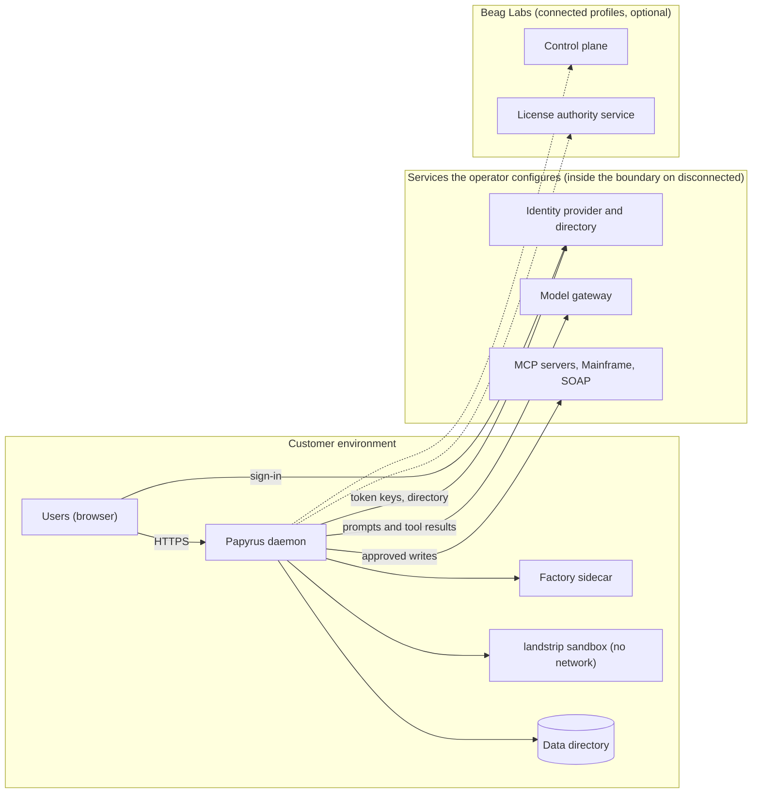
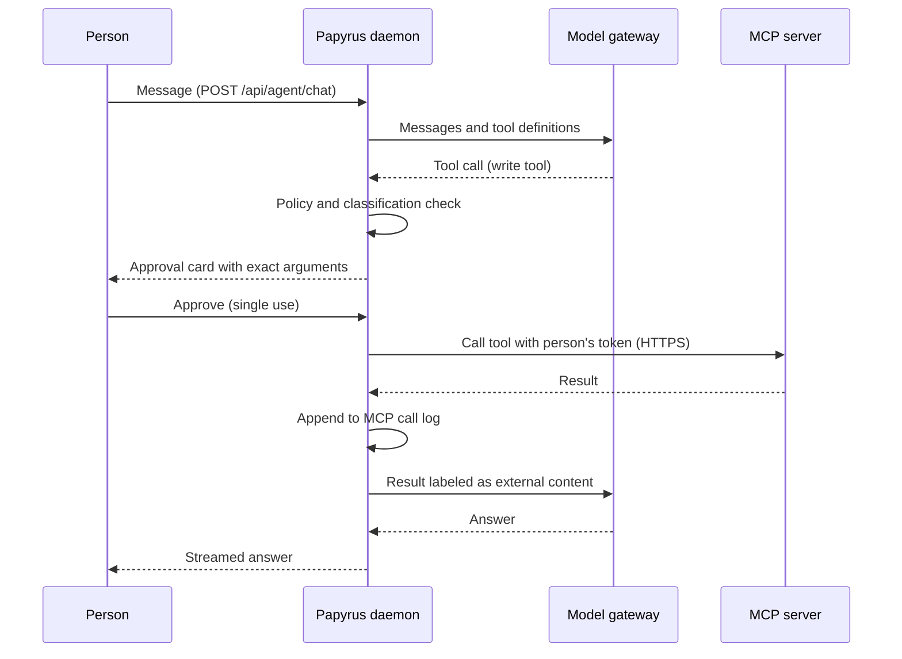
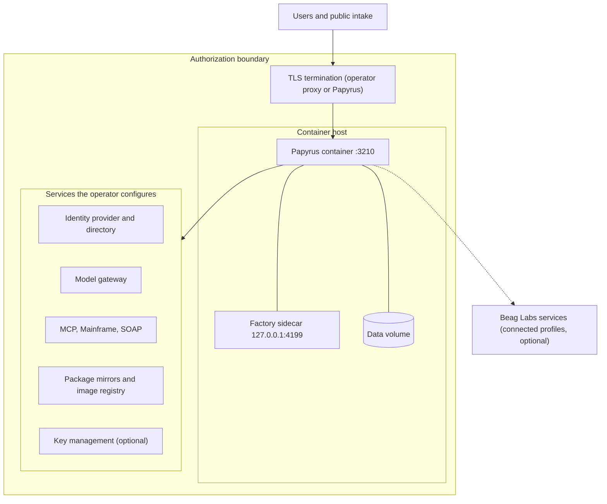

# Papyrus Architecture

Papyrus is a customer-hosted agent runtime published by Beag Labs. This document describes its components, trust boundaries, data flows, storage, and deployment topologies as implemented in the Papyrus source. Control-by-control detail is in the security controls matrix in the same evidence pack.

## Overview

Papyrus is a single-tenant daemon that runs AI agents, workflows, and hosted Apps inside the customer's own environment. Each deployment serves one Microsoft Entra tenant, keeps its state in local LibSQL/SQLite files under one data directory, reaches language models through gateways the customer configures, and reaches customer systems through MCP servers and native Mainframe TN3270 and SOAP connectors. Agents can read and propose; consequential writes require a human approval before they run. Papyrus is built on the Mastra agent framework (`@mastra/core`) and ships as one container image.

## System boundary

**Inside the boundary (this repository, running in the customer environment):**

- The Papyrus daemon (`apps/server`): portal and API, Entra token validation, Mastra agent runtime, workflows and scheduler, policy engine, action ledger and executors, MCP client, Resource Classes and public intake, hosted App serving, update service.
- The web portal (`apps/web`), served as static files by the daemon.
- The Factory sidecar (`apps/factory`), a separate Node process started by the daemon that builds hosted Apps.
- The workspace sandbox: `landstrip` workers (Landlock filesystem confinement plus seccomp, network denied) that run native document programs.
- The data directory (`PAPYRUS_DATA_DIR`, `/var/lib/papyrus` in the image).

**Services Papyrus depends on.** Each is reached at an address the operator configures, over whatever network path the operator provides; none has to be on the public internet. The deployment profile (`commercial`, `government` or `disconnected`) states what Papyrus may assume: on `disconnected`, every service below is an endpoint inside the authorization boundary, and Beag Labs services are not used.

| Service | What Papyrus relies on it for | When it applies |
| --- | --- | --- |
| Identity provider (Microsoft Entra ID) | Human identity: signed tokens, tenant, app roles | Every persistent deployment |
| Directory (Microsoft Graph) | Staff directory lookups; optional first-run app-role setup | When an administrator enables them |
| Model gateway | Model inference over an OpenAI-compatible API | Agent work |
| Customer systems (MCP servers, Mainframe hosts, SOAP services) | Data and actions the customer connects | When configured |
| External key management service | Credential storage, instead of the local encrypted store | When the deployment uses one |
| Beag Labs license authority public keys | Verifying licenses, deployment status and brokered identity assertions | Every deployment; the keys are local configuration, not a network call |
| Beag Labs license authority service (`license.beaglabs.com`) | Deployment registration; usage analytics | Registered deployments on connected profiles; never on `disconnected` |
| Beag Labs control plane (`papyrus.beaglabs.com`) | Entitlement and suspension status, sign-in broker, directory tokens, usage metering | Deployments Beag Labs manages; never on `disconnected` |

All connections to Beag Labs services are initiated by the deployment; the control plane has no inbound path into a deployment. Responses from Beag Labs that carry authority (licenses, deployment status, identity assertions) are verified locally against the configured license authority public keys (`apps/server/src/license.ts`, `verifyAuthoritySignature`).

## Runtime components

| Component | Role | Process / container | Key code path |
| --- | --- | --- | --- |
| HTTP server and portal | Serves the portal, REST and streaming APIs, public intake routes, App content; validates Entra tokens and portal cookies | Daemon process (Node 24), port `3210` | `apps/server/src/agent/http.ts`, `apps/server/src/index.ts` |
| First-run setup server | Collects Entra configuration and generates the portal secret before the daemon is configured | Daemon process, same port, plain HTTP | `apps/server/src/agent/bootstrap-http.ts` |
| Identity | Entra OIDC sign-in, token validation, Teams SSO, brokered sign-in, role assignments | Daemon | `entra-auth.ts`, `microsoft-broker.ts`, `role-assignments.ts` |
| Agent runtime | Mastra agents, sessions, memory, workflows, scheduler, signals | Daemon | `apps/server/src/agent/mastra/runtime.ts` |
| Model gateway | Resolves model profiles and credentials; calls OpenAI-compatible endpoints | Daemon | `model-gateway.ts`, `model-store.ts` |
| Policy engine | Deterministic named policy rules at model, tool, connector, App, and action boundaries | Daemon | `apps/server/src/agent/policies/` |
| Action ledger and executors | Proposal, approval, leased execution for Mainframe TN3270, legacy SOAP, appliance console | Daemon; TN3270 uses a Python bridge child process | `action-store.ts`, `action-worker.ts`, `executors/`, `scripts/tn3270-bridge.py` |
| MCP connector runtime | Registers, verifies, classifies, and calls MCP servers; per-person OAuth tokens | Daemon | `apps/server/src/agent/mcp/` |
| Resource Classes | Customer record types, public forms, request links, signed webhooks, outbound endpoint sends, import sync | Daemon | `apps/server/src/agent/classes/` |
| AgentFS workspace | Durable file authority for Library and session workspaces | Daemon (SQLite via `agentfs-sdk`) | `mastra/workspace-agentfs.ts` |
| Workspace sandbox | Runs fixed native tools (Python, Pandoc, LibreOffice) on a materialized copy of the workspace | `landstrip` worker child processes | `mastra/workspace-nono.ts`, `mastra/workspace-nono-worker.ts` |
| Knowledge Index | Local document embeddings with a pinned Nomic model on CPU | Node worker thread | `document-embeddings.ts`, `embedding-worker.ts`, `scripts/embedding-model.mjs` |
| Hosted Apps | App source, preview builds, publication, sandboxed serving, connector broker | Daemon | `apps/server/src/agent/apps/`, `factory-publication.ts` |
| Factory sidecar | Mastra Factory server that builds Apps; reached only through the daemon's authenticated proxy | Separate Node process bound to `127.0.0.1:4199` | `apps/factory/src/mastra/index.ts`, `mastra-factory/sidecar.ts`, `mastra-factory/proxy.ts` |
| Beag Labs client | Registration, analytics relay, control-plane status, usage metering | Daemon | `provisioning-control-plane.ts`, `beaglabs-analytics.ts`, `control-plane.ts`, `execution-usage.ts` |
| Update service | Receives signed release announcements; requests host updates | Daemon; applied by a host-side updater where the host runs one | `apps/server/src/agent/updates/service.ts`, `deploy/marketplace/vm/papyrus-update.sh` |

The Factory sidecar receives an allow-listed environment only; Papyrus secrets are not passed to it (`mastra-factory/sidecar.ts`, `PASSTHROUGH_ENV`). The daemon strips client `Authorization` and `Cookie` headers when proxying and substitutes a Papyrus-signed token for the signed-in person (`mastra-factory/proxy.ts`).

## Model gateways

**How models are reached.** All chat models are called through one Mastra custom gateway (`PapyrusModelGateway`, `apps/server/src/agent/model-gateway.ts`) that uses `@ai-sdk/openai-compatible`. Each model profile names a base URL, a model, an authentication scheme, and a credential reference. Any provider that exposes an OpenAI-compatible chat completions API can be used. The gateway kinds accepted by the API are `openai-compatible`, `azure-openai`, `ollama`, and `custom` (`packages/contracts/src/index.ts`, `MODEL_GATEWAY_KINDS`). There is no native Anthropic, Bedrock, or Vertex client in the server; those providers are usable only through an OpenAI-compatible endpoint or proxy. When a profile is tested, the gateway reads the provider's `/models` catalog with an 8-second timeout; model calls have a 60-second response-header timeout.

**Endpoint rules.**

- Base URLs must be HTTPS. Plain HTTP is accepted only for `localhost` (`model-store.ts`, `normalizeInput`).
- The `government` and `disconnected` profiles never default to a commercial endpoint. A bootstrap model selector without an explicit `PAPYRUS_MODEL_BASE_URL` is not registered, and an explicit `api.openai.com` or `openai.azure.com` endpoint logs a warning on those profiles. The `ollama` provider defaults to `http://localhost:11434/v1`.
- Without a configured model, sessions, workflows, and connector state still start; work that needs a model is unavailable.

**Where credentials live.** A profile stores only a reference (`env://`, `local://`, `keyvault://`, and other reference schemes; inline values are rejected):

| Reference | Storage |
| --- | --- |
| `local://<profile>` | AES-256-GCM ciphertext in `<data-dir>/secrets.db` (file mode 0600), keyed by a separately provisioned 32-byte master key mounted read-only (`/etc/papyrus/secrets/master.key` or `PAPYRUS_SECRET_KEY_FILE`) (`local-secrets.ts`) |
| `keyvault://…` | A secret in an external key vault, read with the deployment's own identity (`deployment-vault.ts`) |
| `env://VAR` | A process environment variable |

Saved keys are never returned by the API, never placed in model context, and never given to agent workspaces.

**What data leaves.** For each model request, the daemon sends the conversation messages, system instructions, tool definitions, tool results (MCP results are labeled as external content and truncated to 64 KiB), retrieved document passages, and, for vision-capable models, image attachments and rendered PDF pages. Credentials for connectors and MCP servers are never sent. Document embeddings are computed locally and do not leave the deployment.

**Factory sidecar.** The daemon passes the Factory sidecar no model credentials. Model access for Factory builds is configured within Factory itself.

## Integrations

**MCP connectors** (`apps/server/src/agent/mcp/`). Administrators with `Papyrus.Integration.Manage` register remote MCP servers over HTTP transport; there is no stdio transport. A server offers tools only after a verified connection. Each tool is classified `read`, `write`, or `blocked`; new or changed tools default to unreviewed write, and server-supplied hints are not trusted. OAuth tokens are held per server and per person and encrypted in the database. Every call rechecks tenant, verification, classification, and policy. A write requires a single-use approval of that exact call, given by the person whose session made it. Every call is recorded in an append-only log (`papyrus_mcp_calls`) that stores arguments for writes, only a hash for reads, and never tokens or results.

**Resource Class endpoints** (`apps/server/src/agent/classes/`). Inbound: public forms (`/c/`), single-use request links (`/r/`), and signed webhooks (`/hooks/`) are the only unauthenticated Class routes. Outbound: endpoint sends include only configured fields, follow the same egress rules as MCP, and are logged append-only. Class import sync reads only from verified read-classified MCP tools or read-only imported API operations.

**Microsoft Graph.** Used for (a) first-run setup, where an Entra administrator's delegated token adds Papyrus app roles to the customer's registration and is not stored (`entra-app-setup.ts`); (b) the staff directory, using the deployment's own app credentials with the `User.Read.All` application permission (`directory/people.ts`), or, on control-plane deployments, an app-only token issued by the control plane. Graph endpoints follow the configured identity cloud (`PAPYRUS_ENTRA_CLOUD`, `national-cloud.ts`). Mailbox and other Microsoft 365 data access is through an MCP server, not a native connector.

**Legacy systems.** Mainframe TN3270 connections run through a Python `tnz` bridge process with optional TLS per connection (`apps/server/src/agent/apps/legacy/tn3270-session.ts`); writes pass through Mainframe guardrails and the action ledger. Legacy SOAP services are called over HTTP(S) with document/literal bindings. Both are verified live when set up, and hosted Apps can reach only these two connector types, through the guarded legacy runtime.

**Imported APIs and workflow HTTP.** Administrators can import an OpenAPI 3.x description as workflow tools; non-GET operations are `external` and placed behind a `request-approval` step. Workflow `http-get`/`http-post` tools reach public HTTPS hosts.

**How egress is constrained.**

| Path | Rules |
| --- | --- |
| MCP servers, Class endpoint sends, workflow HTTP, imported APIs | Public HTTPS only; credentials in URLs rejected; hosts resolving to loopback, private, or link-local addresses (including cloud metadata) refused unless listed in `PAPYRUS_WORKFLOW_HTTP_INTERNAL_HOSTS`; redirects not followed; customer denylist `PAPYRUS_WORKFLOW_HTTP_DENYLIST` (`mastra/workflow-runtime-tools.ts`) |
| URL previews, SOAP endpoints | Private, loopback, `.internal`, `.local`, and metadata hosts refused unless listed in `PAPYRUS_FETCH_ALLOWED_HOSTS` (`mastra/fetch-preview.ts`) |
| Workspace sandbox | Network always denied by `landstrip`; credential-like environment variables stripped |
| Hosted App frames | `connect-src 'none'`; no direct network; only brokered calls to granted legacy connectors |
| Package installs | Downloaded by the daemon from configured mirrors, then copied into the sandbox; public registries only on connected profiles unless `PAPYRUS_PACKAGE_PUBLIC_REGISTRIES=false` (`package-mirrors.ts`) |

Host-level network policy (firewalls, proxies, segmentation) remains the operator's control.

## Data flows

### 1. Sign-in

1. The browser requests the portal; an unauthenticated request is redirected to `/api/auth/entra/login`.
2. The browser signs in at the Entra authority for the configured national cloud and returns to `/api/auth/entra/callback`.
3. The daemon validates issuer, tenant, audience, signature, expiry, and nonce; only declared Papyrus app roles are honored.
4. The daemon sets a one-hour, HTTP-only portal cookie derived from the validated claims. No local user or password record is created.
5. On control-plane deployments the Microsoft sign-in runs at `papyrus.beaglabs.com`; the daemon receives a one-time handle, redeems it server to server, and accepts only an identity assertion signed by a license authority, addressed to this deployment, for the bound tenant, matching the login nonce, and unexpired. Roles then come from the local `papyrus_role_assignments` table.

### 2. Agent turn with a tool call and approval

1. A signed-in person sends a message (`POST /api/agent/chat`); the daemon loads the session and applies attached policies.
2. The model gateway sends the conversation and tool definitions to the configured model endpoint.
3. The model returns a tool call. Read tools run directly after policy checks.
4. A write MCP tool pauses the turn and shows an approval card with the exact arguments. Approval is single-use and bound to that call.
5. On approval the tool executes, the call is recorded in the append-only log, and the result returns to the model as labeled external content.
6. Action-executor operations (TN3270, SOAP, appliance console) instead become proposals that a person holding `Papyrus.Action.Approve` releases in the action ledger; a leased executor then runs them. The agent cannot call approve, deny, or execute.

### 3. MCP call

1. The runtime confirms the server is verified, the tool is classified read or write (not blocked), and policy allows the call.
2. For writes, the single-use approval ID is checked and consumed.
3. The calling person's OAuth token is decrypted at the call boundary; a failed refresh requires that person to sign in again.
4. The call goes to the server's public HTTPS address (or a listed internal host), with no redirects.
5. The outcome is written to `papyrus_mcp_calls`; the result is truncated and returned to the agent as external content.

### 4. Public form intake

1. A visitor opens `/c/<form-id>`; the daemon answers only for an active, public, inbound form endpoint.
2. The submission is limited to the endpoint's allow-listed fields and bounded file uploads, rate-limited per client and per endpoint, and cannot write person, group, or reference fields or reference Library paths.
3. The record is written directly to the Class.
4. Bound published workflows run as their owner with no roles; each workflow tool call rechecks publication and policy.
5. The visitor receives a receipt that omits sensitive fields and requires an HMAC receipt token.

### 5. App publication

1. App source lives in an AgentFS project (`papyrus.app.json` plus React source), edited in the portal or produced by the Factory sidecar.
2. Preview builds compile pinned dependencies in the isolated workspace with network denied; edits change only the preview candidate.
3. Publication creates a Governance change for an immutable, digest-checked build candidate.
4. On approval, the production pointer moves to that build; source edits never advance it.
5. The App is served at `/a/<app-id>` behind Entra sign-in, in a script-only sandboxed frame with a restrictive CSP and a one-use frame ticket. App code calls `window.papyrus.request()`; the daemon checks durable, operation-specific grants on every call, and writes enter the approval ledger.

## Data storage

All runtime state is under `PAPYRUS_DATA_DIR` (`/var/lib/papyrus` in the image), stored as LibSQL/SQLite files and small JSON files.

| Data | Location | Protection in code |
| --- | --- | --- |
| Daemon state: configuration, policies, action ledger, audit chains, MCP servers and call log, Classes and records, workflows, App releases, API key hashes, role assignments | `agent.db` | Field-level encryption for credentials (below); audit tables append-only by trigger; configuration events SHA-256 hash-chained |
| Session threads and messages | `mastra.db` | None beyond file permissions |
| Schedules and background jobs | `jobs.db` | None beyond file permissions |
| Trace spans and logs | `observability.db` | None beyond file permissions |
| Library and session files | `.agentfs/<id>.db` | None beyond file permissions |
| Model gateway API keys (`local://`) | `secrets.db` | AES-256-GCM; key in a separate master key file mounted read-only |
| Connector runtime credentials, MCP OAuth tokens and client registrations | `agent.db` (`runtime_connector_credentials`) | AES-256-GCM with owner-bound associated data; key derived (SHA-256) from the portal secret |
| Request-link tokens, API key secrets | `agent.db` | Only a SHA-256 digest or a keyed hash is stored |
| Execution usage per hour | `usage.db` | None beyond file permissions |
| Factory projects, sessions, stored credentials | `factory/factory.db`, `factory/sessions/` | Factory credentials encrypted with a key in `factory/secrets.json` (mode 0600) |
| Portal secret and Entra client secret | `bootstrap.json`, or an external key vault | When an external key vault is configured, values live there and the file holds only references |
| Beag Labs deployment credential (registered deployments only) | `beaglabs-registration.json` (mode 0600), or an external key vault | File mode 0600, or the key vault when configured |
| Hosted App secret values | An external key vault, scoped per App | Refused when no key vault is configured |
| Embedding model pack | `models/nomic-embed-text-v1.5` | Checksums verified on install |

The application does not encrypt whole database files. Volume-level encryption is provided, if at all, by the host platform. A host or database administrator can read or replace local state; the documentation recommends exporting audit evidence to independently controlled immutable storage.

## Deployment topology

Papyrus runs as one container (`ghcr.io/beaglabs/papyrus/papyrus`; DoD variant `ghcr.io/beaglabs/papyrus/papyrus-dod`) with a persistent volume, on any OCI-compatible runtime or orchestrator. It makes no assumption about the cloud or hosting platform. The daemon listens on one TCP port (`3210` by default). The Factory sidecar listens on `127.0.0.1:4199` inside the container and is reachable only through the daemon.

**Self-managed.** The operator runs the image with a persistent volume, `PAPYRUS_MODE=persistent`, an HTTPS public origin, identity configuration and a signed license verified locally against `PAPYRUS_LICENSE_AUTHORITIES`. TLS is terminated by the operator's proxy or by the daemon (`PAPYRUS_TLS_CERT`, `PAPYRUS_TLS_KEY`), with certificates from any CA the operator chooses, including a private CA. This is the path for all three profiles, and the only one for `disconnected`.

**Managed by Beag Labs.** The Beag Labs control plane deploys the multi-architecture image by digest and passes `PAPYRUS_CONTROL_PLANE_URL`, `PAPYRUS_DEPLOYMENT_ID` and a one-time `PAPYRUS_BOOTSTRAP_TOKEN`. The deployment then exchanges the token for a deployment credential, checks its signed status hourly, reports hourly usage, and uses the control plane's sign-in broker. While a verified status says suspended or has expired, every API route except health and status returns 402 and the scheduler stops. The hosting infrastructure the control plane uses is defined outside this repository.

**Profiles.** On `disconnected`, the deployment initiates no connection to Beag Labs or to public registries, and every service it uses (identity provider, directory, model gateway, package mirrors, container registry, customer systems) is an endpoint inside the authorization boundary. The DoD image carries the offline license authority key, so a signed license is activated without any network call.

On connected profiles, any of the configured services may instead be reached outside the boundary, for example a public identity cloud or public package registries, as the operator allows. Inbound traffic consists of browser access to the portal and App origins and, when configured, public intake (`/c/`, `/r/`, `/hooks/`), Factory App webhooks and signed update announcements (`POST /api/system/updates`). All other connections are initiated by the deployment.
